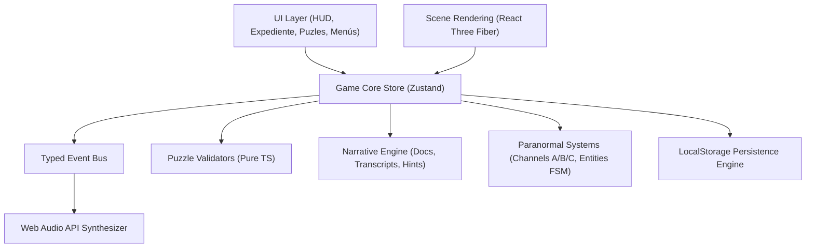

# ARQUITECTURA TÉCNICA — absent_minute

## 1. Visión General

**absent_minute** está diseñado bajo una arquitectura modular desacoplada en **React 18 + TypeScript (strict mode) + Three.js / React Three Fiber + Zustand**.

La regla arquitectónica principal es que **toda la lógica de estado, progresión narrativa, validación de acertijos, inventario, eventos y persistencia reside en módulos puros de TypeScript (`src/core/`, `src/narrative/`, `src/paranormal/`) completamente independientes de React y Three.js**. Esto permite verificar de forma aislada y determinista el 100% de los acertijos, rutas narrativas y finales mediante **Vitest**.

---

## 2. Módulos del Sistema

### 2.1 `src/core/` — Game Core & Event System
- **`types.ts`**: Define todos los tipos de dominio (`SceneId`, `EchoChannel`, `PuzzleId`, `ItemId`, `DocumentId`, `EntityId`, `EndingId`, `GameEvent`, `GameState`, `UserSettings`).
- **`events.ts`**: Bus de eventos tipado (`OBJECT_INSPECTED`, `ITEM_COLLECTED`, `DOCUMENT_FOUND`, `CHANNEL_CHANGED`, `PUZZLE_SOLVED`, `ROOM_ENTERED`, `ENTITY_TRIGGERED`, `STORY_FLAG_UPDATED`, `ENDING_SELECTED`) que desacopla las acciones del jugador de los efectos secundarios (como el sintetizador de audio o las notificaciones del HUD).
- **`puzzles.ts`**: Funciones puras y deterministas de validación para los 5 acertijos del MVP:
  1. `validateEmergencyCircuit`: Comprueba la configuración de los 3 disyuntores del Vestíbulo para alcanzar los `24V` de línea auxiliar sin sobrecarga.
  2. `validateIncompatibleRecords`: Contrasta la bitácora oficial (`02:15` / `02:17`), el monitor de cámara (`CAM-04`) y el canal de residuo (`02:16`).
  3. `validateCalibrationSequence`: Verifica el patrón de impulsos acústicos (`[3, 1, 4, 2, 5]`) del Laboratorio de Calibración.
  4. `validateDiscontinuousCorridor`: Verifica la secuencia de cruces del Pasillo Discontinuo combinando el plano del edificio, el canal acústico activo y el rastro del Residual (`[Canal A: Puerta Norte, Canal B: Esclusa Lateral, Canal C: Umbral de Sincronía]`).
  5. `validateReconstructMinute`: Verifica el orden cronológico de los tres sucesos clave del minuto ausente (`02:16:12 Resonancia anticipada` → `02:16:33 Aislamiento en la esclusa` → `02:16:48 Amputación del registro`).
- **`persistence.ts`**: Serialización segura en `localStorage` con validación de esquema (`SAVE_VERSION = 1`), recuperación ante datos corruptos y guardado automático en transiciones clave.
- **`store.ts`**: Estado global con Zustand que expone acciones puras y despacha eventos al `EventBus`.

### 2.2 `src/narrative/` — Narrative Engine
- **`documents.ts`**: Contiene los **8 documentos narrativos originales** y las **3 transcripciones de grabaciones magnetofónicas**, cada uno con metadatos completos (`id`, `title`, `date`, `author`, `location`, `channelRequired`, `content`, `mysteryConnection`).
- **`hints.ts`**: Sistema progresivo de pistas en 3 niveles (1: Conceptual, 2: Específica, 3: Casi explícita) para cada uno de los 5 acertijos y objetivos de escena.
- **`scenesData.ts`**: Definición declarativa de las 6 escenas, sus objetos interactivos (hotspots), descripciones dependientes del canal acústico (`A`, `B`, `C`), condiciones de acceso y eventos sobrenaturales.

### 2.3 `src/paranormal/` — Paranormal Systems
- **`entities.ts`**: Máquinas de estados finitos (FSM) y reglas de visibilidad/comportamiento para las tres manifestaciones:
  - **Los Residuales**: Secuencias cinéticas repetitivas en Canal B.
  - **Los Testigos**: Presencias estáticas junto a contradicciones documentales que atenúan el sonido ambiental.
  - **El Contador**: Sistema reactivo que incrementa su intensidad conforme el jugador resuelve acertijos y acerca los registros a la verdad de las `02:16`.

### 2.4 `src/audio/` — Web Audio API Procedural Soundscape
- **`soundEngine.ts`**: Sintetizador procedural basado en `AudioContext` sin dependencias externas ni archivos pesados:
  - Zumbido eléctrico de subestación y ventilación filtrada por sala.
  - Tictac mecánico irregular que se detiene abruptamente ante eventos de *El Contador*.
  - Frecuencias diferenciadas por canal del Sintonizador (`440 Hz` Registro, `432 Hz` Residuo con modulación sub-armónica, `417 Hz` Discordancia con batimento binaural suave).
  - Sonidos de impulsos metálicos para el acertijo de calibración.
  - Activación estricta tras la primera interacción del usuario (cumpliendo políticas de autoplay de navegadores).

### 2.5 `src/scenes/` — 3D Scene Rendering (React Three Fiber)
- **`FacilityCanvas.tsx`**: Lienzo 3D principal con cámara suavizada, control de paralaje e inspección mediante ratón/teclado, iluminación atmosférica reactiva al canal del Sintonizador y geometría procedural modular para las 6 áreas:
  1. `vestibulo` (Vestíbulo de Recepción)
  2. `vigilancia` (Sala de Vigilancia)
  3. `archivo` (Archivo Documental)
  4. `laboratorio` (Laboratorio de Calibración)
  5. `pasillo` (Pasillo Discontinuo)
  6. `camara` (Cámara de Sincronización)
- **`ParanormalEntities3D.tsx`**: Representación artística 3D de **Los Residuales** (siluetas de partículas desfasadas), **Los Testigos** (contornos de polvo suspendido y vacío óptico) y **El Contador** (marcas numéricas luminosas `02:16` y péndulos sincronizados).

### 2.6 `src/ui/` — Interfaz de Usuario Mínima y Accesible
- **`MainMenu.tsx`**: Menú principal con Continuar, Nueva Partida, Opciones, Créditos y advertencia de fotosensibilidad/interferencia.
- **`HUD.tsx`**: Barra superior e inferior minimalista con selector del **Sintonizador de Ecos** (Canales A, B, C), inventario de hasta 4 objetos, acceso al Expediente (`Tab`), Pistas (`H`) y subtítulos accesibles con indicador de dirección/naturaleza sonora.
- **`DossierModal.tsx`**: Expediente personal con pestañas para Documentos (8), Transcripciones (3), Cronología/Observaciones y Objetivo Actual.
- **`PuzzleModal.tsx`**: Interfaces diegéticas e interactivas para los 5 acertijos del juego, operables tanto con ratón como con teclado.
- **`EndingScreen.tsx`**: Secuencia audiovisual controlada para los dos desenlaces (**Final A: El silencio preservado** y **Final B: La transmisión**).
